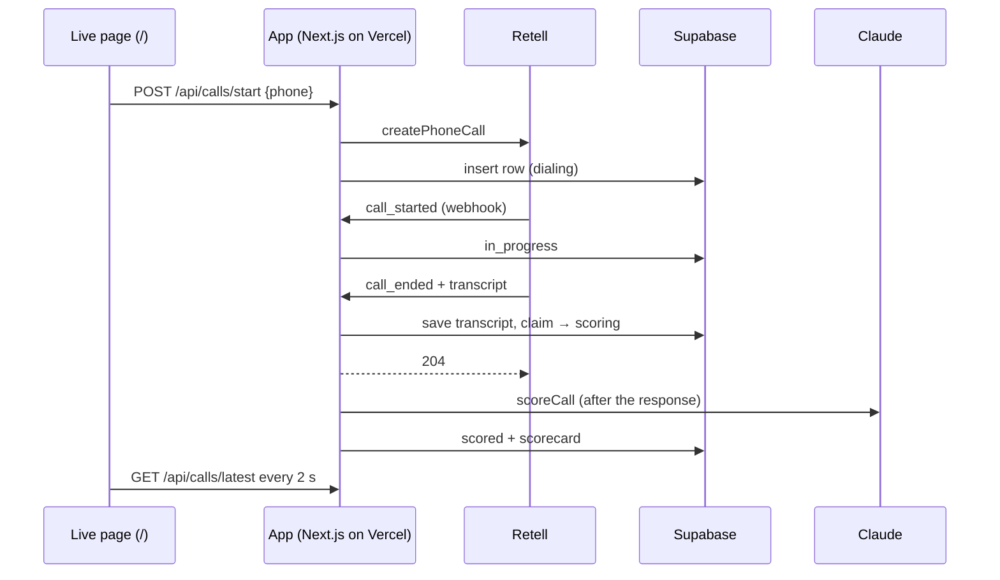

# Front Desk Trainer (demo)

An AI caller ("Jessica", hosted on Retell) phones a med spa front desk trainee, they role-play a Botox
price-shopper call, and a graded scorecard appears on the live page within ~15 seconds of hang-up.

This repo is everything around the call: the call-start route, the Retell webhook, LLM scoring,
one Supabase table, and three pages behind a shared password.



## Local setup

```bash
npm install
cp .env.example .env.local   # fill in the values below
npm run dev                  # http://localhost:3000, log in with any username + DEMO_PASSWORD
npm test                     # unit tests (no network)
```

Database: run `supabase/migrations/0001_create_calls.sql` once in the Supabase SQL editor.
It creates `calls`, enables RLS with no policies, revokes everything from `anon`/`authenticated`,
grants `service_role` select/insert/update, and adds a trigger that stamps `updated_at` on every update.

To receive webhooks locally, run a tunnel to port 3000 (for example
`ngrok http --url=<your-domain> 3000`) and point the Retell agent's webhook at
`https://<tunnel>/api/webhooks/retell`.

## Environment variables

| Name | Purpose |
| --- | --- |
| `RETELL_API_KEY` | Verifies webhook signatures and places outbound calls. Must be the key with the webhook badge in Retell's dashboard. |
| `ANTHROPIC_API_KEY` | Scoring calls |
| `SCORING_MODEL` | Scoring model ID. Currently `claude-sonnet-5-5`. |
| `SUPABASE_URL` | Supabase project URL |
| `SUPABASE_SECRET_KEY` | The `sb_secret_...` key. Server-side only; never exposed to the browser. |
| `DEMO_PASSWORD` | Shared password (HTTP basic auth, any username) for every page and API route except the webhook |
| `NEXT_PUBLIC_DEMO_PHONE_NUMBER` | Retell number in E.164. Used as `from_number` and shown on the live page. |

## Scripts

| Command | What it does |
| --- | --- |
| `npm run score -- fixtures/good_botox_1.txt` | Scores one transcript, prints the scorecard and latency |
| `npm run score:fixtures` | Scores all five fixtures and compares every criterion to `fixtures/expected.json`. Exits non-zero only on a label mismatch; warns on calls over 12 s. |
| `npm run rescore -- <call id>` | Re-scores a stored call (row uuid or Retell `call_...` id) and saves `scored` or `failed`. Use it for calls stuck in `scoring` or after prompt changes. |
| `npm run demo:replay -- good_botox_2` | Live-demo fallback. Plays a fixture through the real pipeline: `in_progress` for ~3 s, then `scoring`, then `scored`. The live page tags it "Recorded call"; **tell the room it is a recording.** |

All scripts read `.env.local` and talk to the same Supabase database as production, so
`demo:replay` run from a laptop drives the production live page.

### Measured scoring latency (`npm run score:fixtures`, `claude-sonnet-5-5`, Nov 14 2026)

Six consecutive runs with the final prompt, all labels matching:

| Run | good_botox_1 | good_botox_2 | medium_botox_1 | medium_botox_2 | bad_botox_1 | Median |
|---|---|---|---|---|---|---|
| 1 | 5513 | 5925 | 6043 | 5365 | 6057 | 5925 ms |
| 2 | 6333 | 5978 | 6329 | 5627 | 6901 | 6329 ms |
| 3 | 4928 | 5848 | 6142 | 5868 | 6324 | 5868 ms |
| 4 | 5674 | 6421 | 5740 | 5757 | 6419 | 5757 ms |
| 5 | 5735 | 6412 | 6007 | 5531 | 6623 | 6007 ms |
| 6 | 5433 | 5960 | 5752 | 6243 | 6760 | 5960 ms |

One earlier tuning run had a single 16.5 s outlier. Real calls measured 5.7–7.2 s of scoring and
7.5–9.8 s from hang-up to scorecard.

## Deploy

```bash
vercel link                      # project: frontdesk-trainer
vercel env add <NAME> production # for each variable above
vercel deploy --prod
```

The webhook route sets `maxDuration = 60`; scoring runs after the 204 via `after()` from `next/server`
and caps itself at 55 s including SDK and validation retries.

## Retell webhook URL

Set it on the agent, not account-wide, so other agents are unaffected: Retell dashboard →
Agents → the Jessica agent → webhook settings → Agent Level Webhook URL →
`https://<production-domain>/api/webhooks/retell`. Only one URL can be active, so switching it to a
tunnel for local work takes production off the live loop until you switch back.

The agent should also: wait for the other side to speak first on outbound calls, and have voicemail
detection on, set to hang up.

## Demo-day notes

- **Outbound calls from a new number may show as "Spam Likely", or be silenced entirely on iPhones with
  "Silence Unknown Callers" on.** Test "Call me" on the presenter's phone beforehand. The inbound number
  shown under the form is the fallback, and `npm run demo:replay -- good_botox_2` is the fallback for that.
- Let unanswered calls ring through to voicemail; that ends as "No answer". Declining also ends as
  "No answer" (`user_declined`).
- One call at a time, and at most 10 outbound calls per hour.
- If a call is stuck on "Scoring" for more than a minute the page shows "We couldn't score that call";
  `npm run rescore -- <id>` recovers it.

## Changes from the spec, and why

- **No temperature setting.** The API rejects `temperature` for `claude-sonnet-5-5`
  ("deprecated for this model") and SDK 1.8.0 no longer accepts it, so scoring isn't fully deterministic.
  The fixture labels held across six runs after the prompt changes below.
- **Three prompt additions** (approved by the project owner) so the fixtures match their labels:
  a speech-to-text rule in `scoring-prompt.md` (judge names by sound: "GloMedSpa" means Glow Medspa);
  in `confirmed`, a volunteered name counts if the employee used it, and only the day and time must be
  repeated back; in `accurate_info`, stutters, filler words, and "I'd have to check" are not hedged facts.
- **Numbers are masked everywhere in `raw_payload`, not just `call.from_number`/`call.to_number`.**
  Real payloads repeat the caller's full number in `custom_sip_headers` and
  `retell_llm_dynamic_variables`; the webhook replaces every occurrence of both call numbers.
- **Transcript prefixes are `User: ` / `Agent: `** (capitalized) in real payloads and in
  `good_botox_2.txt`, not `user:`/`agent:` as the spec says. All parsing is case-insensitive;
  `transcript_object` roles are lowercase.
- **`NO_RESPONSE_NEEDED` never appeared** in any captured payload (none of the test calls asked Jessica
  to hold), so whether Retell drops it is unconfirmed. The filter stays in place for transcripts,
  transcript objects, turn counting, scoring, and display.
- **No-answer mapping** (from Retell's disconnect docs, checked Nov 14 2026): every `not_connected` code
  (`dial_no_answer`, `dial_busy`, `dial_failed`, `user_declined`, `invalid_destination`,
  `marked_as_spam`, `network_blocked`, `telephony_provider_permission_denied`,
  `telephony_provider_unavailable`, `sip_routing_error`) plus `voicemail_reached` and `ivr_reached`.
  It is checked before the too-short rule because a voicemail transcript is one short line.
- **Migration additions:** `revoke all on calls from anon, authenticated` (Supabase granted them
  TRUNCATE/REFERENCES/TRIGGER by default) and an `updated_at` trigger.
- **Next.js 16:** the password gate is `proxy.ts` (Next 16 renamed `middleware`); route files may only
  export handlers, so webhook and call-start logic live in `lib/`.
- **`web_call` events are ignored.** Retell's dashboard "test webhook" button sends a signed
  `call_started` for a fake `web_call` (`call_id: "test_call"`) that never ends; storing it made an
  `in_progress` row that blocked the live page and "Call me" for 15 minutes. The demo uses phone calls
  only, so web calls (including dashboard test calls) never create rows.
- **Replay duration** is the real ~3 s the replay took, since a fixture has no call length.
- **The call-start route returns 409 for a retried request once the first one succeeded**, because the
  active-call check runs before Retell's idempotency key. The disabled button prevents this in practice.
